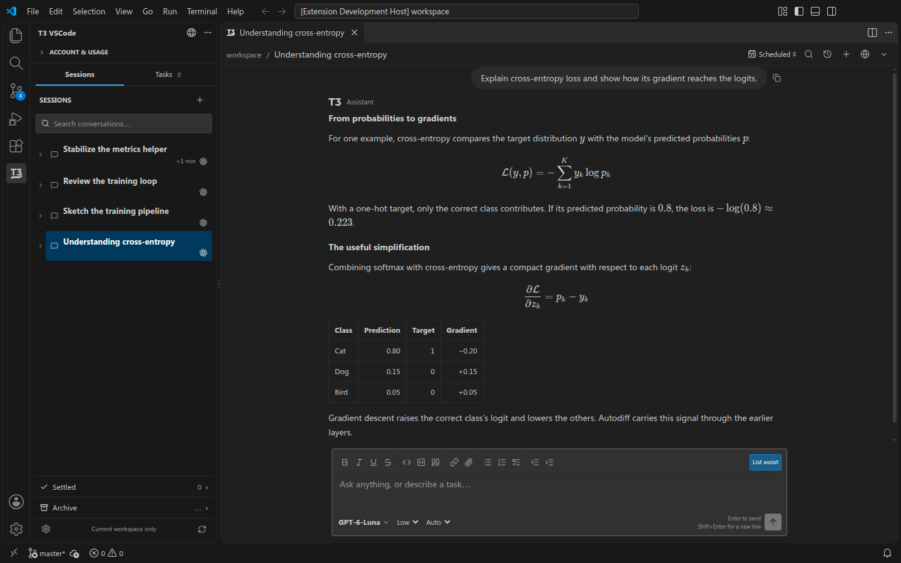
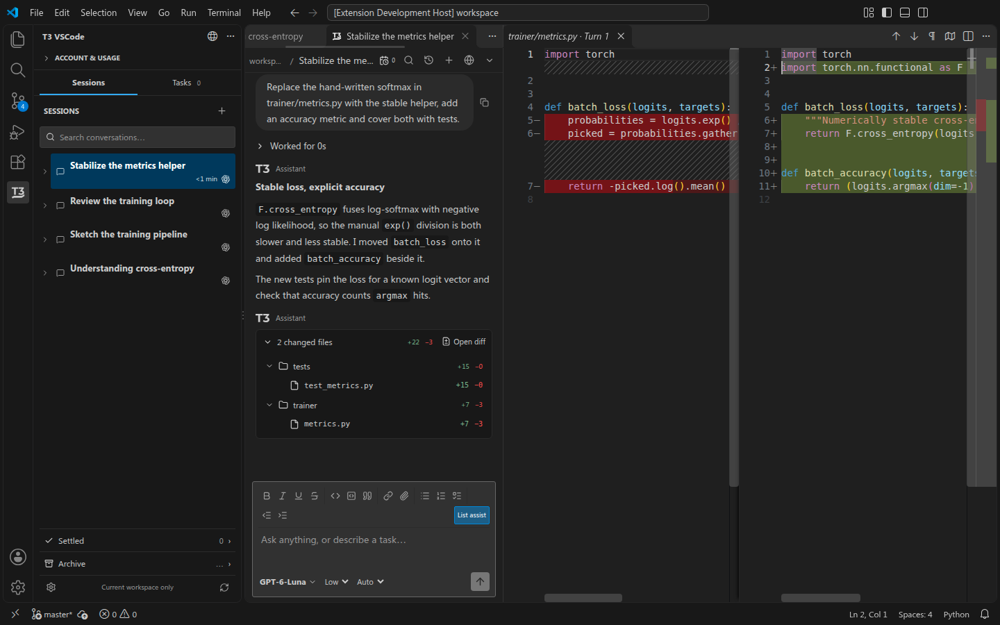
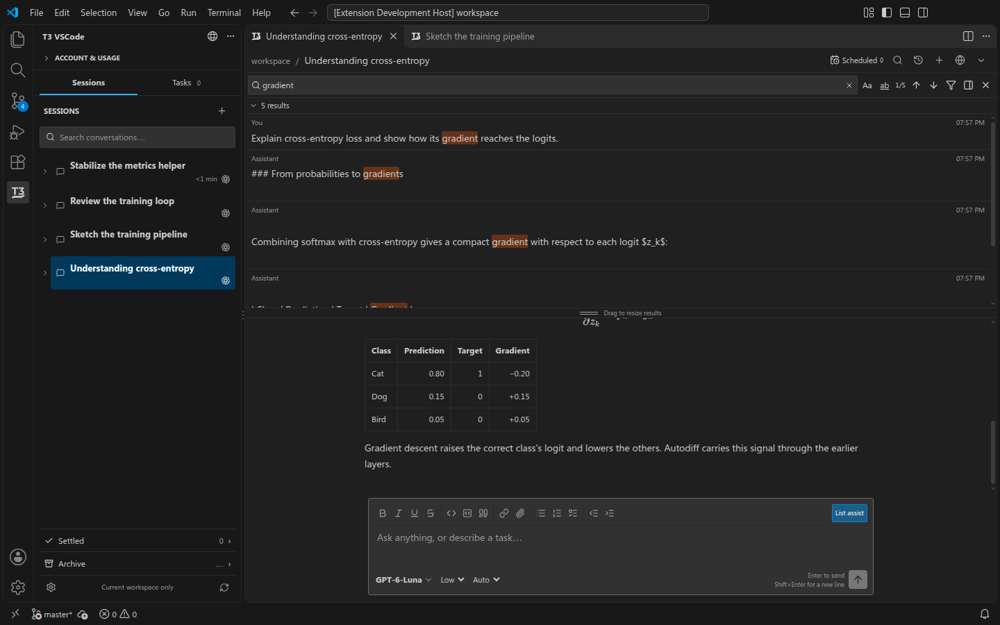
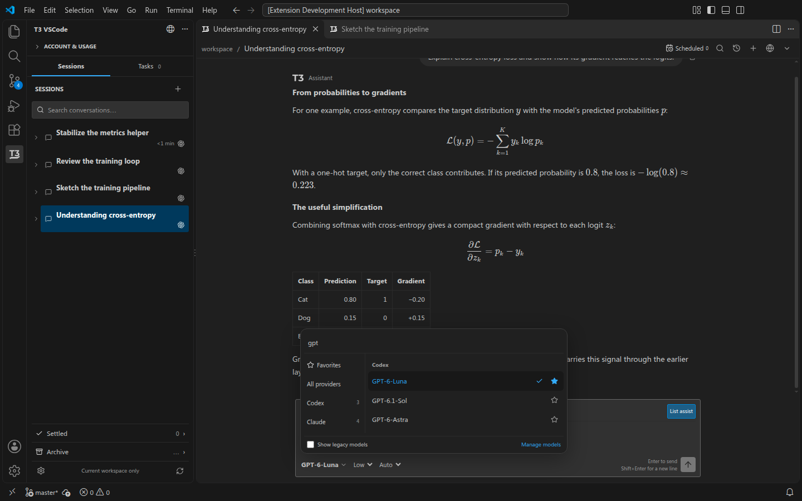
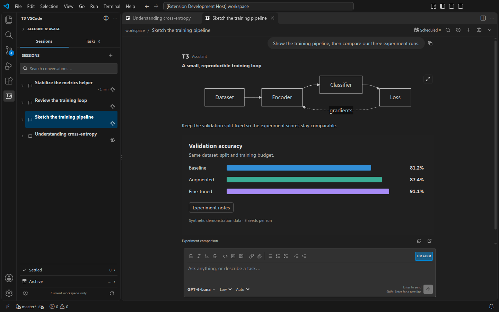
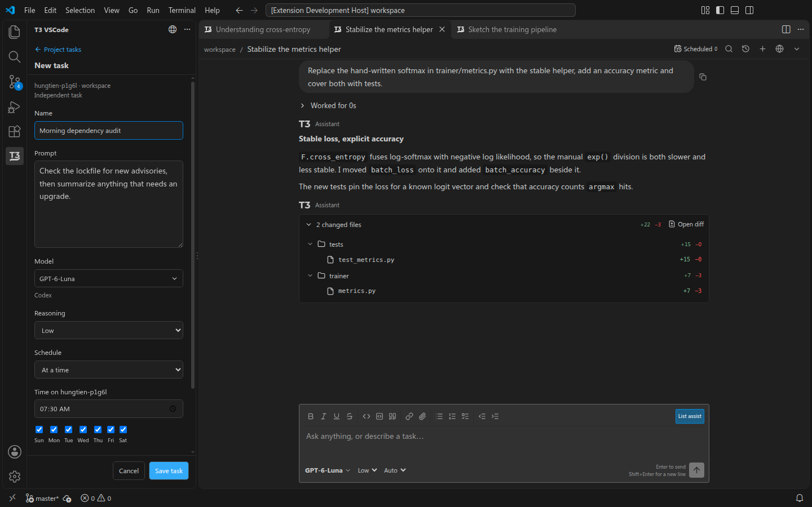
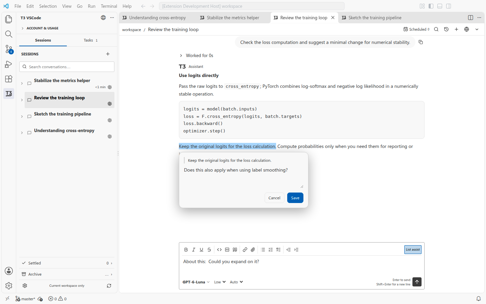

# T3 VSCode

A VS Code client for a separately running [T3 Code](https://github.com/pingdotgg/t3code) server: workspace sessions and agent chat in editor tabs, beside your code instead of in a browser. Colors follow your VS Code theme.

0.1.19 is on the [Marketplace](https://marketplace.visualstudio.com/items?itemName=hungtienhuang.t3-vscode) prerelease channel; 0.1.18 remains on the release channel.

## This fork

This is [Fundryi/t3-native-vscode](https://github.com/Fundryi/t3-native-vscode), a fork of [busFred/t3-vscode](https://github.com/busFred/t3-vscode) (the text below this section is his README). Upstream and this fork, side by side:

| | Upstream: busFred/t3-vscode | This fork |
|---|---|---|
| Chat UI | Native React chat in VS Code | Upstream's native chat, in the side bar by default |
| Agents see VS Code | No | MCP bridge (workspace, tabs, selection, problems, git, terminal; open file, reveal, diff) |
| Approvals | In the chat only | Notifications with buttons, keyboard answers |
| Files into the chat | Attach button, Alt+K inserts a selection | "Add to prompt" menu, Shift+Alt+K for a selection, Ctrl+C in the Explorer then Ctrl+V, a drop view |
| Upstream merges | n/a | Our code lives in `src/*/ours/`; his files get the smallest hooks; `git merge upstream/main` works |

What the fork adds on top of upstream (every item has a live test in [docs/ours/FORK-FEATURES.md](docs/ours/FORK-FEATURES.md)):

- **Agents understand this VS Code window.** A loopback MCP server per window; Claude Code and Codex started by T3 get tools for the workspace, open tabs, the active file and selection, problems, git state, terminal output, and can open a file, reveal it or show a diff.
- **Approvals and questions as VS Code notifications**, answerable by keyboard (Alt+1, Alt+2, ...) and from the status bar.
- **Status bar** shows which chat runs and for how long; a click goes there. Toasts when a turn finishes, none for the chat you are reading.
- **Add to prompt**: right-click a file, a folder or a selection; Shift+Alt+K sends the selected lines with their line numbers. Ctrl+C in the Explorer, then Ctrl+V in the chat, inserts file references. A "Drop zone" view takes dragged files while VS Code 1.140+ blocks drops into webviews (an Electron change, see FORK-FEATURES I).
- **Keys**: focus the chat, new chat, next chat that needs you, Escape stops a running turn, Ctrl+N in a chat starts a new one.
- **Chat in the side bar** by default (setting to use editor tabs instead), VS Code's own colours, your T3 default model for new chats, plan mode visible and switchable, a context meter, secret requests as a card.
- **Changes**: a changes card per turn, open the edited file at the change, revert a hunk with VS Code's own arrow, show all changes of a turn.
- **Threads**: deep links, open in the desktop app, snooze, regenerate title, mark unread, copy branch or id, archive with undo, stop a subagent from its card.
- **Robustness**: auto-reconnect with buttons, pairing works with only the T3 desktop app, errors you can read, long output opens in an editor, screen readers hear new cards.
- **t3.json scripts as VS Code tasks**, save all files on send.

Install: the VSIX under `target-installer/` (`pnpm run package`), keeping the upstream extension id. Windows is the first-class platform here; the upstream checks run on Windows too (see docs/STATUS.md).

## In the editor

Captured from the extension in an isolated VS Code window with synthetic conversations.

*Sessions beside the conversation. Equations, tables and code render in the editor tab.*

*A response's agent-only changes, opened in VS Code's read-only diff editor.*

*Find in session searches the whole recorded conversation.*

*Any model the server advertises, with its effort and permission mode.*

*Mermaid diagrams and T3 HTML graphics render in the transcript.*

*Scheduled tasks get their own model, effort and schedule.*

*Quote a passage and comment on it; the reference lands at your prompt cursor.*

## What you get

| | |
| --- | --- |
| Sessions | Workspace-scoped projects, threads and subagents; rename, pin, settle, archive. |
| Editor tabs | One conversation per tab, each with a durable draft and its own History picker. |
| Rich transcripts | Markdown, code, tables, images, media, Mermaid, T3 HTML graphics, KaTeX math. |
| Code-aware prompts | Ctrl/Cmd+K inserts a file reference; **Cite** quotes a reply; `@` files, `/` commands. |
| Agent control | Server models, effort and permission modes, Stop, queue and steer, approvals. |
| Review | Agent-only response diffs in VS Code's diff editor; full-history **Find in session**. |
| Usage and tasks | Status-bar account meters; a Tasks tab for T3 scheduled work. |

## Get started

T3 Code and its providers are separate applications you install and run yourself.

1. Install the T3 Code CLI — [installation guide](https://github.com/pingdotgg/t3code/blob/main/docs/user/install.md).
2. Run `t3`, then connect a provider under **Settings → Providers**.
3. In VS Code, open the **T3 VSCode** view and choose **Retry connection**.

Pairing is automatic. Running T3 as a [background service](https://github.com/pingdotgg/t3code/blob/main/docs/user/background-service.md) is optional; if connection fails, **Connection details** names the failed stage.

## Scope and limitations

- Alpha. Linux is the first verified platform.
- Local servers only; remote T3 servers are not supported yet.
- Specialized tool previews and interactive checkpoint restore remain later work; rendering is not full web-app parity.
- No embedded terminal, and moving a chat between windows is unverified.

## More

- [User guide](docs/user-guide.md) — setup, every setting, how each feature behaves.
- [Feature history](docs/feature-history.md), [changelog](CHANGELOG.md) — what changed, by version.
- [Development and testing](docs/development.md) — build, debug, verify.
- [Publishing](docs/publishing.md) — version policy and release procedure.
- [Support](SUPPORT.md) — reporting bugs.

[MIT licensed](LICENSE). T3-derived code keeps [its upstream notice](vendor/LICENSE.t3code); bundled dependencies keep their own.
